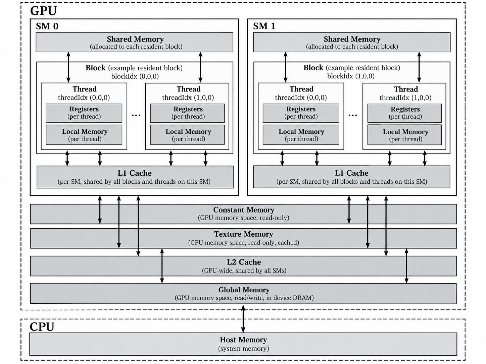
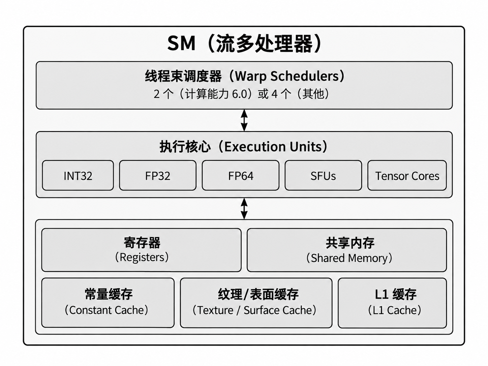

# CUDA 内存组织与 SM 资源

## 内存层级与访问范围

CUDA 内存采用分级设计：**片上存储延迟低但容量有限；显存容量大但访问延迟高**。内存的「可见范围」与「物理位置」是两个不同概念。



> 图示注意：**L1 Cache 属于 SM**，而非某个 Block；**L2 Cache 为 GPU 多个 SM 共享**。图中的 Local Memory 画在线程内部表示“线程私有”，其实际存储通常在设备显存中。

下表的“是否可读写”以 **Kernel 中的设备代码**为视角；L1/L2 是缓存，不是可单独分配和寻址的内存空间。

| 内存 | 物理位置 | 可见范围 | 是否可读写 | 作用与特点 |
|---|---|---|---|---|
| **Register**（寄存器） | SM 片上 | 单个 Thread | 可读写 | 访问最快；存储编译器分配的线程私有变量 |
| **Local Memory**（局部内存） | 设备内存空间，可经缓存访问 | 单个 Thread | 可读写 | 寄存器溢出、部分动态索引数组可能使用；延迟较高 |
| **Shared Memory**（共享内存） | SM 片上 | 同一 Block | 可读写 | 由程序显式使用，方便线程协作和数据复用 |
| **Global Memory**（全局内存） | GPU 显存（DRAM） | 所有 Thread | 可读写 | 容量大；`cudaMalloc` 分配 |
| **Constant Memory**（常量内存） | 设备内存，配有常量缓存 | 所有 Thread | 只读；Host 可更新 | 同一 Warp 读同一地址时效率高 |
| **Texture**（纹理） | 设备内存及相关缓存路径 | 跨 Block | 通过纹理接口只读 | 支持纹理采样、寻址与过滤等功能 |
| **Surface**（表面） | 设备内存及相关缓存路径 | 跨 Block | 通过表面接口可读写 | 用于支持表面访问的 CUDA 数组 |
| **L1 Cache** | SM 片上 | 所属 SM 的访问请求 | 不单独寻址；由硬件管理 | 缓存部分加载请求，减少对 L2/显存的访问 |
| **L2 Cache** | GPU 片上 | 多个 SM 的访问请求 | 不单独寻址；由硬件管理 | 缓存设备内存读写流量，减少显存访问 |

- **局部变量 ≠ Local Memory**：例如 `int n = ...`、`float tmp = ...` 通常位于寄存器；寄存器不够时发生 **Register Spilling（寄存器溢出）**，编译器可能使用 Local Memory。
- Global / Local Memory 可利用缓存；**Local** 指线程私有，不代表物理位置接近 SM。

### L1 / L2 Cache：由硬件管理的数据复用

**缓存命中（Hit）** 表示所需数据已经在当前缓存中，可以直接从该层读取；**缓存未命中（Miss）** 则需要向更下一级请求数据。重复访问或访问相邻数据可能利用已有缓存内容，减少显存流量；一次性扫描大量数据时，缓存收益可能较小。

**L1 Cache 属于单个 SM**，服务该 SM 上执行的线程。设备内存加载可按架构、指令和缓存策略选择经过 L1，也可能绕过 L1 访问 L2；因此不能把所有访问都理解成固定的“L1 → L2 → DRAM”流程。L1 主要帮助复用该 SM 近期读取的数据，Global Memory 与 Local Memory 的加载都可能受益；具体缓存路径依 GPU 架构而异。

部分现代架构将 L1、纹理缓存与 Shared Memory 统一或共享片上资源。**更多 Shared Memory 分配可能减少 L1 的可用容量**，但具体划分及配置能力取决于设备，不能把固定的 L1/Shared 容量套用于所有 GPU。

**L2 Cache 由整个 GPU 的多个 SM 共享**，位于 SM 与设备显存之间。它缓存设备内存的读写流量：L2 命中可以避免本次请求继续访问 DRAM，也让不同 SM 对相同设备数据的访问有机会复用缓存内容。L2 的共享不意味着程序可以直接读取“另一个 SM 的 L1”，也不意味着不同 SM 的执行会自动同步。

**Shared Memory 由程序显式声明、分配并组织访问；L1/L2 的填充与替换主要由硬件负责**。程序访问的是原始内存地址，不能用 `cudaMalloc` 单独分配一块 L1/L2，也不能假定数据会一直留在缓存里。缓存容量、命中延迟、写入策略和哪些请求经过某层缓存均依架构与访问路径而异。

**缓存不能代替线程同步或内存可见性保证**。Block 内协作仍需合适的同步；跨 Block 通信需要正确的同步与原子操作等机制，仅仅“经过共享的 L2”不能保证读取时序正确。性能分析时可结合 NCU 的 L1/L2 命中情况与 DRAM 流量，判断缓存是否实际减少了显存访问。

---

## Global、Constant 与 Shared Memory 的用法

### Global Memory：动态分配与静态设备变量

```cpp
float *d_x;
cudaMalloc((void**)&d_x, N * sizeof(float));  // 动态全局内存
cudaFree(d_x);

__device__ int d_counter = 1;               // Kernel 外定义：静态设备变量
__device__ int d_arr[2];
```

`__device__` 用在**变量声明**上表示设备端变量；静态设备变量无需 `cudaMalloc`，Kernel 可直接引用其名字。Host 端通过符号复制函数访问：

```cpp
int h_arr[2] = {10, 20};
cudaMemcpyToSymbol(d_arr, h_arr, sizeof(h_arr));   // Host → GPU symbol
// kernel<<<1,1>>>();
cudaMemcpyFromSymbol(h_arr, d_arr, sizeof(h_arr)); // GPU symbol → Host
```

`cudaMemcpy(dst, src, bytes, kind)` 面向**地址**；`cudaMemcpyToSymbol(symbol, src, bytes)` 面向**静态设备符号**。

### Constant Memory：Warp 统一读取

```cpp
__constant__ float d_coeff[2];

float h_coeff[2] = {2.0f, 3.0f};
cudaMemcpyToSymbol(d_coeff, h_coeff, sizeof(h_coeff));
// Kernel 中可读 d_coeff[0]，不可写
```

- `const` 是 C++ **只读类型限定符**，不指定存储位置；`__constant__` 指定 CUDA **设备常量内存空间**，设备代码只读。
- 同一 Warp 的 32 个线程**读取相同常量地址**时可利用广播；读取大量不同地址可能发生访问串行化。教材给出的用户常量内存容量为 **64 KB**。
- Kernel 的**传值参数**通常由常量参数空间提供；教材所述的 **4 KB 参数上限**是旧架构/旧版本约束，不宜当作所有现代设备的统一上限。
- `__ldg(&d_x[n])` 是只读加载内建函数；现代 GPU 和编译器通常已能自动利用相关缓存路径，无需一律显式调用。

### Shared Memory：Block 内共享

```cpp
__global__ void example() {
    __shared__ float tile[256];  // 每个 Block 有自己的一份
    int tid = threadIdx.x;
    tile[tid] = (float)tid;
    __syncthreads();             // 同一 Block 的线程同步
}

example<<<1, 256>>>();           // 256 Threads / Block，与数组长度对应
```

同一 Block 的线程共享 `tile`，不同 Block 不共享这份数组；它与 `cudaDeviceSynchronize()`（Host 等待设备工作完成）不是同一类同步。

**静态 Shared Memory 用量**：按声明计算，`tile[256]` 使用 `256 × sizeof(float) = 256 × 4 = 1024 Bytes = 1 KiB`，这是**每个 Block**的用量，不是每个线程的用量。若同一 SM 同时驻留 4 个这样的 Block，这个数组合计占用 4 KiB。编译器可能优化掉未实际使用的数据（如上面的教学代码），实际静态用量以编译器报告为准。

**动态 Shared Memory 用量**由 Kernel 启动配置的第三个参数指定，单位为 **Bytes**：

```cpp
__global__ void dynamic_example(float *out) {
    extern __shared__ float tile[];
    int tid = threadIdx.x;
    tile[tid] = (float)tid;
    __syncthreads();
    out[blockIdx.x * blockDim.x + tid] = tile[(tid + 1) % blockDim.x];
}

// 假设 d_out 已分配至少 grid * 256 个 float，grid 是有效的 Block 数。
dynamic_example<<<grid, 256, 16 * 1024>>>(d_out);  // 每个 Block 申请 16 KiB
dynamic_example<<<grid, 256, 32 * 1024>>>(d_out);  // 每个 Block 申请 32 KiB
```

这两次启动虽然只访问前 256 个 `float`，但申请的是完整的 16/32 KiB，资源约束按申请量计算。动态数组大小并不由线程数自动决定，程序需确保所有数组访问都在申请范围内。

每个 Block 的**程序申请量 = 静态 Shared Memory + 启动时指定的动态 Shared Memory**。例如一个 Kernel 还有 1 KiB 静态数组，同时申请 16 KiB 动态空间，总申请量为 17 KiB；上面的 `dynamic_example` 没有静态共享数组，因此分别申请 16/32 KiB。实际驻留限制还要考虑设备的每 Block 上限、分配粒度及可能的额外预留；不要将 Grid 中全部 Block 的用量都算作同时驻留在一个 SM 上。

---

## SM 的构成与 Occupancy

SM（Streaming Multiprocessor）是执行线程块的主要硬件单元，包含 **Warp Scheduler、执行单元、寄存器、共享内存和缓存**。



> 上图按教材资源分类绘制，为**概念图而非现代 GPU 的精确电路布局**。图中的“2 或 4 个 Warp Scheduler”是教材所举架构的配置，不代表所有现代 SM；实际数量、核心比例和缓存结构依 GPU 架构而异。

- **计算资源**：FP32（单精度）、FP64（双精度）、INT32（整数）、SFU（特殊数学函数）、Tensor Core（矩阵/混合精度计算）。
- **调度资源**：Warp Scheduler 选择准备执行的 Warp（通常 32 Threads），将指令发往相关执行单元；**Thread 不与 CUDA Core 一一对应**。
- **存储资源**：Register File 为线程分配寄存器；Shared Memory 物理上属于 SM，每个驻留 Block 获得独立使用的区域；L1 为 SM 级缓存。

**Occupancy（SM 占有率）**：

$$
\mathrm{Occupancy} = \frac{\text{Resident Warps per SM}}{\text{Max Resident Warps per SM}} \times 100\%
$$

分子是该 SM 当前驻留的 Warp 数，分母是该 SM 硬件允许的最大驻留 Warp 数。**驻留不等于正在执行，也不等于已经准备就绪**：一个 Warp 即使正在等待内存或同步，只要仍驻留在 SM 上，也计入 Occupancy。

影响 Occupancy 的主要因素：**Block Size、每个线程的寄存器用量、每个 Block 的 Shared Memory 用量，以及 SM 的硬件上限**。Block Size 通常选 32 的整数倍（常见 128 或 256），以避免不完整 Warp 的浪费。

例如教材假设某 SM 最多驻留 **2048 Threads**，若每个线程占用 **64 个寄存器**、SM 总共只有 **65536 个 32-bit 寄存器**，则单由寄存器容量推算，最多容纳 `65536 / 64 = 1024` 个线程，**Occupancy 上限约 50%**（忽略寄存器分配粒度等限制）。

**Shared Memory 限制的例子**：与上面的寄存器算例分开计算，假设某 SM 可用 Shared Memory 为 **64 KiB**，最多驻留 **2048 Threads**，每个 Block 有 **256 Threads**；寄存器、最大驻留 Block 数等其他资源不构成瓶颈，且每个 Block 的申请量不超过设备上限。

每个 Block 有 `256 / 32 = 8 Warps`，该 SM 的硬件 Warp 上限为 `2048 / 32 = 64 Warps`；线程上限允许最多驻留 `2048 / 256 = 8 Blocks`。

| 每个 Block 的 Shared Memory | 共享内存允许的驻留 Block 数 | 结合线程上限后的驻留 Block 数 | 驻留 Warp 数 | 理论 Occupancy 上限 |
|---|---|---|---|---|
| 16 KiB | `64 / 16 = 4` | `min(4, 8) = 4` | `4 × 8 = 32` | `32 / 64 = 50%` |
| 32 KiB | `64 / 32 = 2` | `min(2, 8) = 2` | `2 × 8 = 16` | `16 / 64 = 25%` |

因此，**即使线程数不变，每个 Block 的共享内存用量翻倍，也可能使可驻留 Block 数和 Occupancy 上限减半**。这是忽略分配粒度、额外预留等约束的教学计算；实际值需结合设备参数、编译器资源报告和 NCU 检查。这里计算的是理论上限，运行时实际 Occupancy 还受工作量与执行过程影响。

**Occupancy ≠ GPU 利用率 ≠ 性能**。更多驻留 Warp 有助于隐藏访存延迟，但追求 100% Occupancy 可能增加寄存器溢出，反而变慢。

---

## 查询 GPU 设备属性

```cpp
cudaDeviceProp prop;
cudaGetDeviceProperties(&prop, 0);       // 0 为 GPU 设备编号
printf("GPU: %s\n", prop.name);
printf("SMs: %d\n", prop.multiProcessorCount);
printf("Max Threads/Block: %d\n", prop.maxThreadsPerBlock);
printf("Max Threads/SM: %d\n", prop.maxThreadsPerMultiProcessor);
printf("Registers/SM: %d\n", prop.regsPerMultiprocessor);
printf("Shared Memory/SM: %zu\n", prop.sharedMemPerMultiprocessor);
```

`cudaDeviceProp` 是 GPU 属性结构体，`&prop` 让 API 将查询结果写回；`cudaSetDevice(1)` 可选择设备 1（存在时）。教材的 1024/2048 Threads 等 SM 限额是特定架构参数，**以实际设备查询为准**。

```bash
nvcc --ptxas-options=-v app.cu -o app  # 查看编译器报告的寄存器等资源用量
```

---

## Nsight Compute（NCU）：Kernel 性能分析〔补充工具〕

**NCU 分析单个 Kernel 为什么慢**；Nsight Systems（`nsys`）先看程序整体时间线，找出耗时的 Kernel。NCU 是教材第六章之外的现代工具补充。

```bash
nvcc -O3 -lineinfo app.cu -o app
ncu ./app                                     # 基础性能分析
ncu --section LaunchStats --section Occupancy ./app
ncu --section MemoryWorkloadAnalysis ./app     # 访存与缓存
ncu --set full -o report ./app               # 完整报告，开销较大
ncu-ui report.ncu-rep                        # 图形界面查看
```

| NCU 报告 | 建议先看什么 |
|---|---|
| **Launch Statistics** | Grid / Block Size、Registers per Thread、Shared Memory per Block |
| **Occupancy** | Theoretical / Achieved Occupancy，限制因素 |
| **Memory Workload Analysis** | L1/L2 访问、缓存命中情况、显存带宽 |
| **Scheduler / Warp State** | Warp 是否准备就绪、等待原因（Stall） |

不同 GPU / NCU 版本支持的分析分组可能不同，可用 `ncu --list-sections` 查看。性能计数器权限不足时需检查运行环境与驱动设置。NCU 采样/重放有额外开销，不要直接把分析工具内的运行耗时当作无干扰基准。

---

## 最后速记

```text
存储：Register（线程私有，片上） / Local（线程私有，设备内存）
      Shared（Block 私有区域，片上） / Global（所有线程可访问，显存）
缓存：L1 属于 SM；L2 跨 SM 共享；Shared Memory 由程序显式管理
符号：__device__ 静态设备变量；__constant__ 设备常量内存
      cudaMemcpyToSymbol / FromSymbol：主机与静态设备符号间复制
硬件：GPU → 多个 SM；SM → 调度器 + 计算单元 + 寄存器 + 片上存储
调度：Warp = 32 Threads；Block 在一个 SM 上执行
占有率：驻留 Warps / 最大允许驻留 Warps；受 Block、Register、Shared 限制
分析：cudaDeviceProp 查硬件；ncu 看 Kernel 的 Occupancy、寄存器、缓存和 Stall
```

相关笔记：[CUDA 基础](CUDA%20%E5%9F%BA%E7%A1%80.md) · [CUDA 程序调试与性能优化](CUDA%20%E7%A8%8B%E5%BA%8F%E8%B0%83%E8%AF%95%E4%B8%8E%E6%80%A7%E8%83%BD%E4%BC%98%E5%8C%96.md)。

参考：樊哲勇《CUDA 编程：基础与实践》第六章；补充工具参考 [NVIDIA Nsight Compute CLI](https://docs.nvidia.com/nsight-compute/NsightComputeCli/index.html) 与 [Profiling Guide](https://docs.nvidia.com/nsight-compute/ProfilingGuide/)。
